# RescueSwarm Pose Dataset

**Teaching drones to see people from above, and to tell who needs help first.**
*NIDAR 2.0 (2026–27) · Track 1: Drone Innovation · Team RescueSwarm*

[](RescueSwarm_PoseSet_v0.1/qa/validation_report.md)
[](RescueSwarm_PoseSet_v0.1/LICENSE_LEDGER.csv)
[](RescueSwarm_PoseSet_v0.1/annotations/coco/)
[](RescueSwarm_PoseSet_v0.1/annotations/mpii/)
[](website/)

**300 aerial and disaster-exercise images. 519 people. 17 keypoints, a body outline and a posture label for every one of them.**

This repository holds the dataset package, the toolchain that builds and checks it, and an interactive website that shows it off.

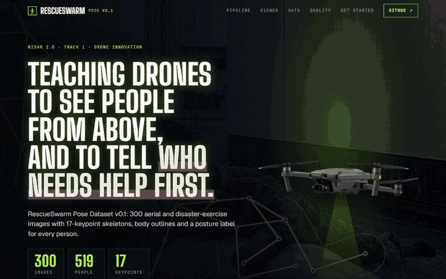

| | |
|---|---|
| **Dataset** | [`RescueSwarm_PoseSet_v0.1/`](RescueSwarm_PoseSet_v0.1/) · or the one-file [`RescueSwarm_PoseSet_v0.1.zip`](RescueSwarm_PoseSet_v0.1.zip) (40.7 MB) |
| **Website** | [`website/`](website/) · run it locally, or deploy it on Vercel with the button below |
| **Model** | [`yolov8n-pose.pt`](yolov8n-pose.pt), a pretrained YOLOv8-pose edge model |

[](https://vercel.com/new/clone?repository-url=https%3A%2F%2Fgithub.com%2Fsuvronilchatterjee7-create%2FNIDAR&root-directory=website&project-name=rescueswarm-pose-dataset)

---

## Contents

1. [The idea](#1-the-idea)
2. [The dataset at a glance](#2-the-dataset-at-a-glance)
3. [A tour of the website](#3-a-tour-of-the-website)
4. [What's in this repo](#4-whats-in-this-repo)
5. [Quickstart: the dataset](#5-quickstart-the-dataset)
6. [Run and deploy the website](#6-run-and-deploy-the-website)
7. [Licensing and attribution](#7-licensing-and-attribution)
8. [Known limitations](#8-known-limitations)

---

## 1. The idea

### What is NIDAR?
**NIDAR** (National Innovation Challenge for Drone Application and Research) is a national drone innovation initiative organised by the **Drone Federation India (DFI)** in partnership with the **Ministry of Electronics and Information Technology (MeitY)** under the SwaYaan programme.

- **Track 1 (Drone Innovation):** swarm drones for disaster response and GPS-denied indoor navigation.
- **Track 2 (Component Innovation):** flight controllers designed around India's indigenous **VEGA** processor (C-DAC, RISC-V).

### What RescueSwarm does
RescueSwarm sends a collaborative drone swarm over disaster zones: earthquake rubble, flood zones, collapsed structures. The onboard vision stack works in four passes:

| Step | What happens | Why it matters for search and rescue |
|---|---|---|
| **1. Detect** | Finds people from top-down and oblique viewpoints | Rescuers can't reach people the drone never spots |
| **2. 17 keypoints** | Predicts the COCO body keypoints for each person | Joint positions show how a body is arranged, not just where it is |
| **3. Body outline** | Builds an outline polygon from the keypoints with deterministic geometry | A tight outline separates a person from rubble and shadow better than a box |
| **4. Posture** | Classifies `upright`, `crouching`, `seated` or `lying` | `lying` marks a likely casualty for priority triage |

### Why a new dataset
Standard benchmarks (COCO, MPII) mostly show people upright, at ground level and large in the frame. A drone camera sees them from above or at a steep angle, small in the frame, often lying down or partly hidden by debris. This set is a seed for fine-tuning lightweight edge models (YOLOv8-pose) and for checking the keypoint-to-outline conversion.

---

## 2. The dataset at a glance

| | |
|---|---|
| **Images** | 300 (`rs_000001.jpg` to `rs_000300.jpg`) |
| **People** | 519 annotations, 1.73 per image on average |
| **Split** | train 240 images / 422 people · val 30 / 44 · test 30 / 53 (80 / 10 / 10) |
| **Sources** | **Source A:** 150 open-licensed real aerial and disaster-exercise photos from Wikimedia Commons (331 people) · **Source B:** 150 synthetic renders of articulated rigs on rubble, asphalt, grass and dirt (188 people) |
| **Formats** | COCO Keypoints 1.0 (17 keypoints) · MPII-style (16 joints + activity labels) |
| **Validation** | All checks pass. The COCO → MPII → COCO round trip matches exactly on the 12 shared joints for all 519 people |

| Posture | People | Share |
|---|---|---|
| `upright` | 274 | 52.8% |
| `crouching` | 117 | 22.5% |
| `lying` (casualty) | 75 | 14.5% |
| `seated` | 53 | 10.2% |

**Camera view:** oblique 77.5% · top-down 14.1% · ground level 8.5%
**Occlusion:** none 64.7% · partial 29.1% · heavy 6.2%
**Review status:** 188 reviewed (36.2%, synthetic rigs with exact geometry) · 331 unreviewed (63.8%, real photos pre-labelled by YOLOv8-pose with automated checks)

Full breakdowns: [`qa/class_balance.md`](RescueSwarm_PoseSet_v0.1/qa/class_balance.md) and [`qa/validation_report.md`](RescueSwarm_PoseSet_v0.1/qa/validation_report.md).

---

## 3. A tour of the website

The site in [`website/`](website/) presents the dataset as a drone's-eye mission screen. Every number on it comes from the files in this repo.

### The hero, and a drone that flies down the page

The page opens on the tagline, three counters and a hovering drone with its light on. As you scroll, the drone leaves the hero and glides left and right down the page. Its light swings onto each section headline in turn, lighting it up, and moves on to the next one below once a headline has scrolled past.

| Hero | The light reaching the next headline |
|---|---|
| 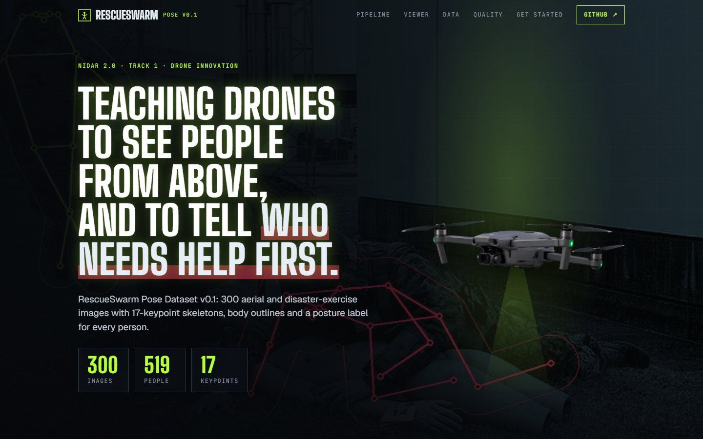 | 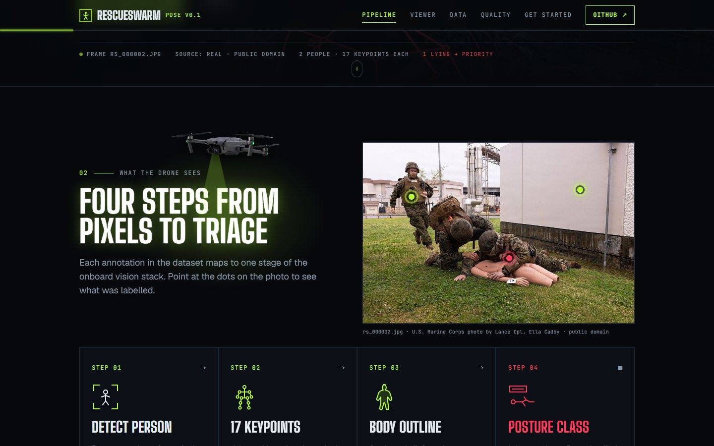 |

### Photo hotspots and the annotation viewer

A real photo from the dataset carries three pulsing dots. An **Explore** ring follows the cursor over the photo; point at or click a dot and a card explains what was labelled there.

The viewer redraws each frame's layers live from the COCO JSON. Toggle keypoints, outlines and posture labels, browse eight frames (four real, four synthetic), and hover a person to isolate them.

| Photo hotspot | Annotation viewer |
|---|---|
| 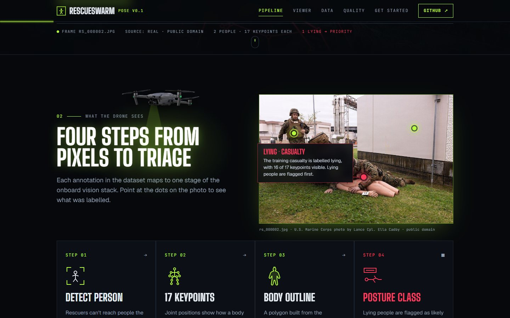 | 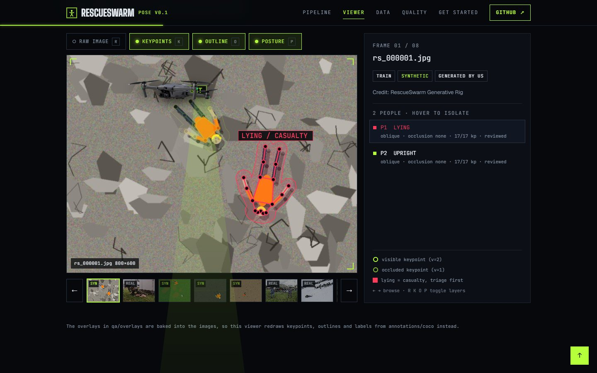 |

### Charts, sources, quality and download

| Dataset at a glance | Real vs synthetic |
|---|---|
| 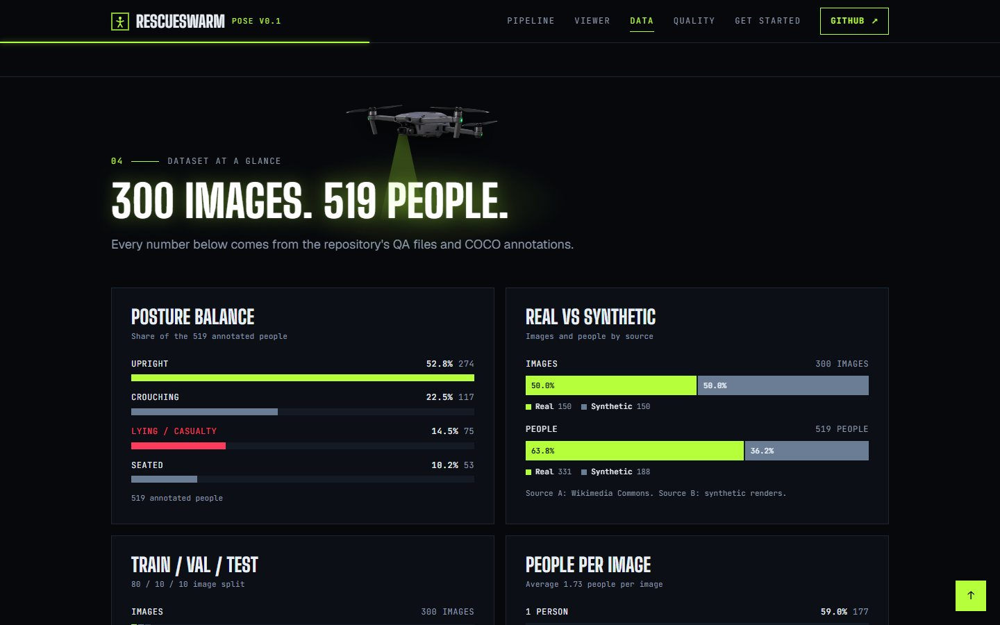 | 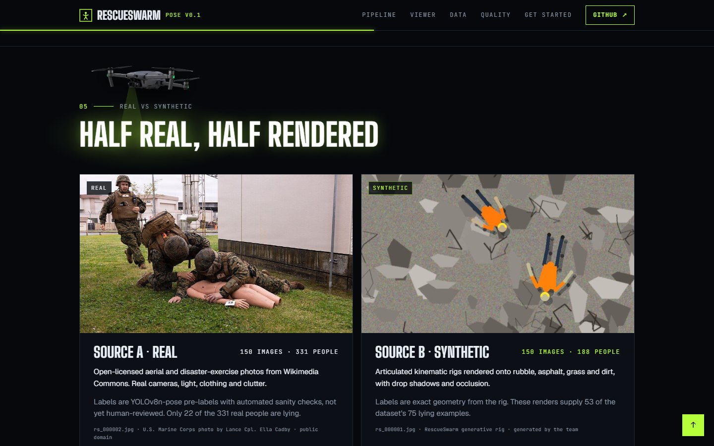 |
| **Validation, CVAT review and licence ledger** | **Get started** |
| 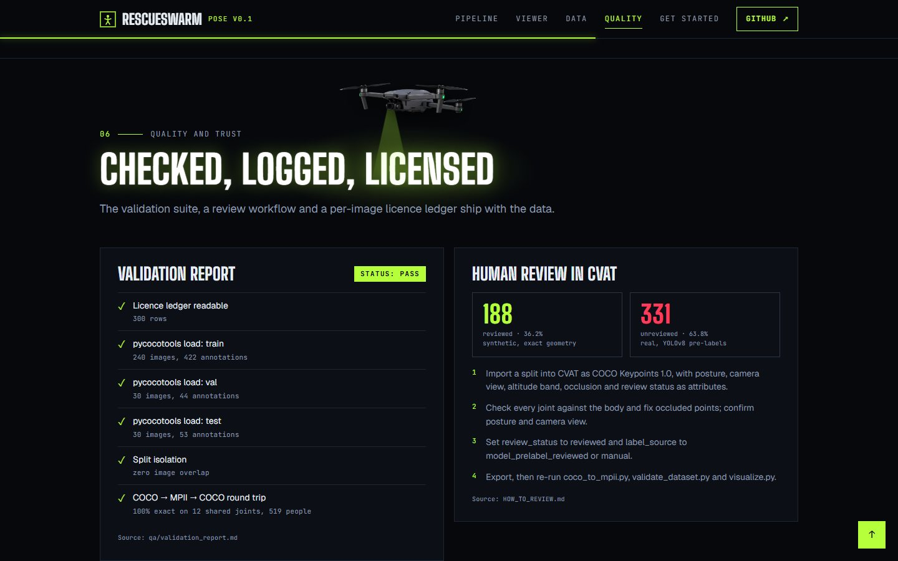 | 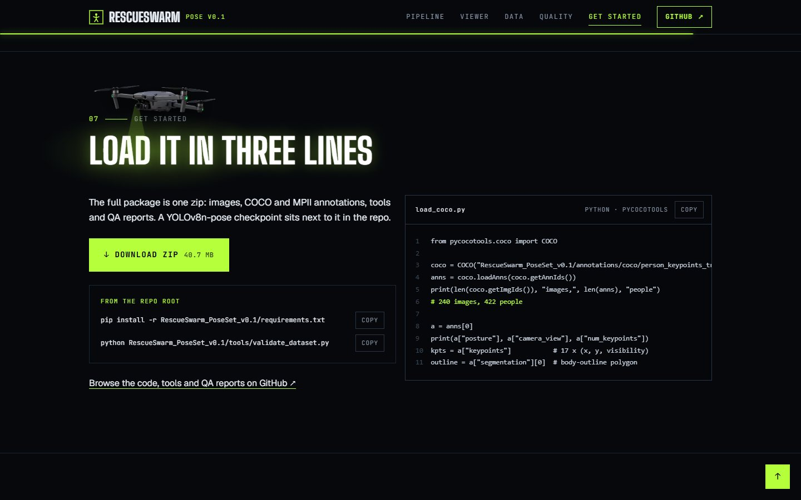 |

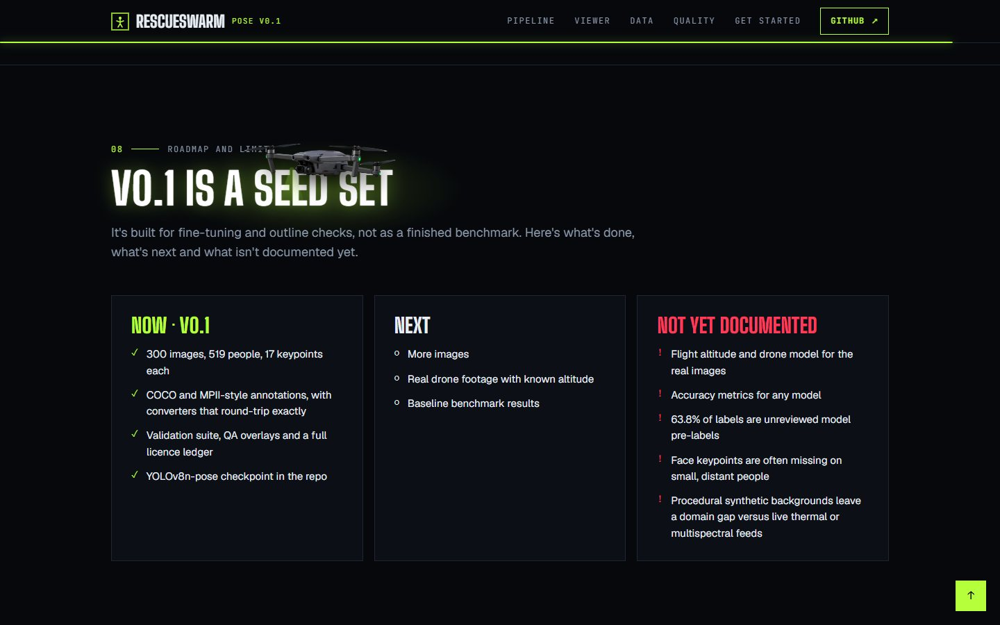

### On phones

| Hero | Drone over a headline | Hotspot card |
|---|---|---|
| 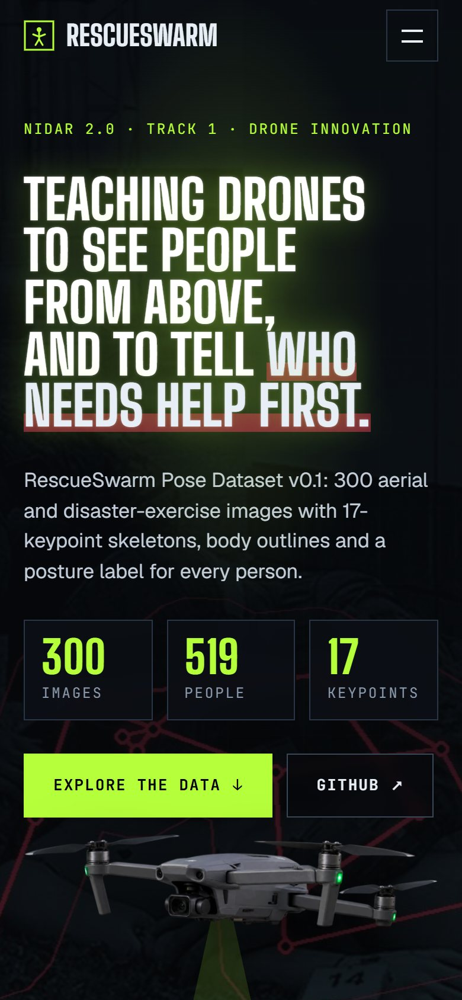 | 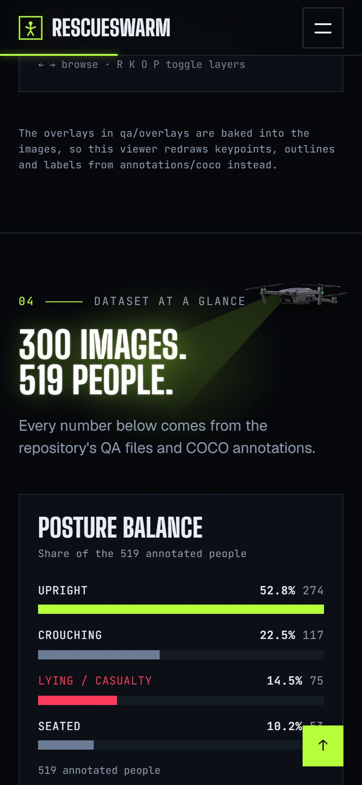 | 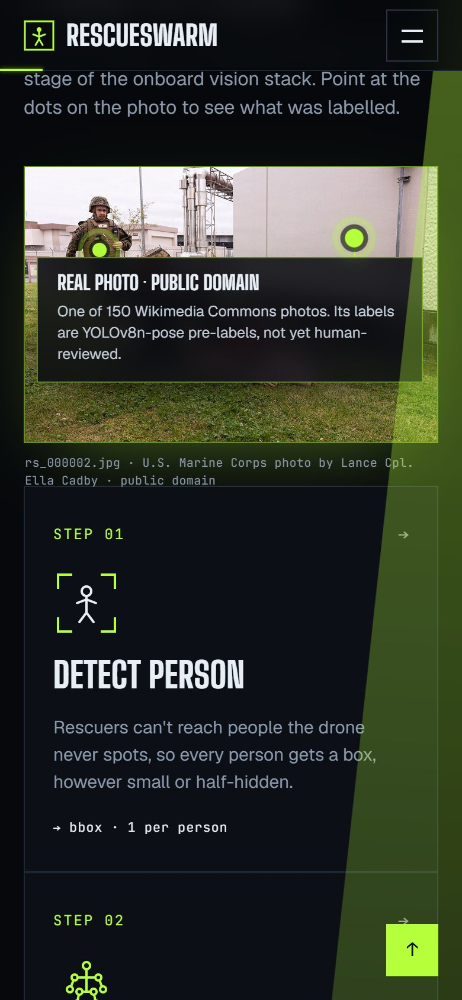 |

On phones the drone rides the right edge and angles its light onto each headline, and hotspot cards open across the photo. With **reduced motion** turned on, the drone stays in the hero and nothing animates.

---

## 4. What's in this repo

```
NIDAR/
├── RescueSwarm_PoseSet_v0.1/          # The dataset
│   ├── README.md                      # Detailed dataset documentation
│   ├── LICENSE_LEDGER.csv             # Provenance and licence for every image
│   ├── HOW_TO_REVIEW.md               # CVAT import/export review instructions
│   ├── requirements.txt               # Pinned Python dependencies
│   ├── images/                        # 300 images: train 240 · val 30 · test 30
│   ├── annotations/
│   │   ├── coco/                      # COCO Keypoints JSON
│   │   └── mpii/                      # MPII-style JSON
│   ├── tools/
│   │   ├── build_outline.py           # Deterministic body-outline polygon builder
│   │   ├── coco_to_mpii.py            # COCO → MPII converter
│   │   ├── mpii_to_coco.py            # MPII → COCO converter
│   │   ├── validate_dataset.py        # Automated QA suite
│   │   └── visualize.py               # Overlay renderer
│   └── qa/
│       ├── overlays/                  # 35 visual check overlays
│       ├── validation_report.md       # Validation results
│       └── class_balance.md           # Postures, views, altitude bands, occlusion
├── RescueSwarm_PoseSet_v0.1.zip       # The whole dataset in one zip (40.7 MB)
├── yolov8n-pose.pt                    # Pretrained YOLOv8-pose edge model
├── website/                           # The project website (Vite + React)
│   ├── src/                           # Sections, viewer, charts, flying drone
│   ├── public/images/                 # Compressed dataset images and the drone
│   └── vercel.json                    # Vercel build settings
├── docs/screenshots/                  # Images in this README
└── README.md                          # This file
```

---

## 5. Quickstart: the dataset

**Install**
```bash
pip install -r RescueSwarm_PoseSet_v0.1/requirements.txt
```

**Load it in Python**
```python
from pycocotools.coco import COCO

coco = COCO("RescueSwarm_PoseSet_v0.1/annotations/coco/person_keypoints_train.json")
anns = coco.loadAnns(coco.getAnnIds())
print(len(coco.getImgIds()), "images,", len(anns), "people")   # 240 images, 422 people

a = anns[0]
print(a["posture"], a["camera_view"], a["num_keypoints"])
kpts = a["keypoints"]           # 17 x (x, y, visibility)
outline = a["segmentation"][0]  # body-outline polygon
```

**Validate the dataset**
```bash
python RescueSwarm_PoseSet_v0.1/tools/validate_dataset.py
```

**Convert between formats**
```bash
# COCO to MPII
python RescueSwarm_PoseSet_v0.1/tools/coco_to_mpii.py \
  --coco_input RescueSwarm_PoseSet_v0.1/annotations/coco/person_keypoints_train.json \
  --mpii_output RescueSwarm_PoseSet_v0.1/annotations/mpii/mpii_style_train.json

# MPII to COCO
python RescueSwarm_PoseSet_v0.1/tools/mpii_to_coco.py \
  --mpii_input RescueSwarm_PoseSet_v0.1/annotations/mpii/mpii_style_train.json \
  --coco_output RescueSwarm_PoseSet_v0.1/annotations/coco/person_keypoints_train.json
```

**Render check overlays**
```bash
python RescueSwarm_PoseSet_v0.1/tools/visualize.py --num 35
```

To review or correct labels by hand, follow [`HOW_TO_REVIEW.md`](RescueSwarm_PoseSet_v0.1/HOW_TO_REVIEW.md): import a split into CVAT as COCO Keypoints 1.0, check each person, mark it reviewed, export, then re-run the converters and the validator.

---

## 6. Run and deploy the website

**Run it locally**
```bash
cd website
npm install
npm run dev        # http://localhost:5173
```

`npm run build` writes a static site to `website/dist/`. It needs no backend and no environment variables.

**Deploy on Vercel**
1. Click **Deploy with Vercel** at the top of this README, or in Vercel choose **Add New → Project** and import this repository.
2. Set **Root Directory** to `website`. Vercel reads [`website/vercel.json`](website/vercel.json): framework Vite, install `npm ci`, build `npm run build`, output `dist`.
3. Click **Deploy**. Every push to `main` then redeploys the site, and other branches get preview links.

More detail is in [`website/README.md`](website/README.md).

---

## 7. Licensing and attribution

Every one of the 300 images is listed in [`LICENSE_LEDGER.csv`](RescueSwarm_PoseSet_v0.1/LICENSE_LEDGER.csv) with its source URL, author and licence.

| Licence | Images | Commercial use | Condition |
|---|---|---|---|
| Generated by the team (Source B, synthetic) | 150 | Yes | None |
| Public domain (Wikimedia Commons) | 123 | Yes | None |
| CC BY 4.0 (Wikimedia Commons) | 15 | Yes | Attribution |
| CC BY 2.0 (Wikimedia Commons) | 5 | Yes | Attribution |
| CC BY-SA 2.0 (Wikimedia Commons) | 7 | Yes | Share-alike |
| **Total** | **300** | | |

All 300 images can be used for academic, competition and open research work. 293 (97.7%) allow direct commercial use; the 7 CC BY-SA 2.0 images also require share-alike.

The website shows dataset images rs_000001, rs_000002, rs_000011, rs_000012, rs_000014, rs_000015, rs_000272 and rs_000274. Their credits are on the site and in the ledger.

---

## 8. Known limitations

v0.1 is a seed set, not a finished benchmark.

1. **Model pre-labels.** 63.8% of annotations are YOLOv8-pose pre-labels with automated checks and are not yet human-reviewed. Keypoints may be slightly off on complex terrain; [`HOW_TO_REVIEW.md`](RescueSwarm_PoseSet_v0.1/HOW_TO_REVIEW.md) explains how to fix them in CVAT.
2. **Face keypoints on distant people.** Eyes, nose and ears often have low visibility (`v=0` or `v=1`) on small subjects shot from above 30 m.
3. **Synthetic backgrounds.** The rigs model articulation, shadows and occlusion realistically, but the backgrounds are procedurally generated and may differ from live thermal or multispectral drone feeds.
4. **Not yet documented.** Exact flight altitudes and drone models for the real photos, and accuracy metrics for any model.

**Next:** more images, real drone footage with known altitude, and baseline benchmark results.

---

Built by **Team RescueSwarm** for NIDAR 2.0.
